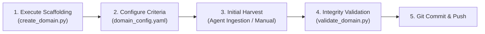

# Contributing to LitNexus: Multi-Domain Laboratory Guidelines
# LitNexus コントリビューション規約：新規研究領域の追加と共有

> **Scope**: Standard Operating Procedures for Laboratory Members & Collaborators  
> **対象**: 研究室の所属メンバーおよび共同研究者  
> **Language Standard**: Academic English & Academic Japanese (日英併記)

---

## 1. Collaborative Philosophy / 共同研究における設計思想

### [English]
`LitNexus` is engineered under the principle of **Zero-Interference Modularity**. Each research area exists as an autonomous sub-repository under `domains/<domain_name>`. Adding, updating, or reorganizing one domain will never incur Git merge conflicts with another researcher's work.

### [日本語]
`LitNexus`は、**「相互干渉ゼロのモジュール構造（Zero-Interference Modularity）」**を基本原則としています。各研究テーマは `domains/<ドメイン名>` 配下の完全独立したサブディレクトリとして管理されます。自身の担当領域で論文の追加や再編を行っても、他のメンバーの作業領域とGitの競合（Merge Conflict）が発生することはありません。

---

## 2. Step-by-Step: Adding a New Research Domain / 新規研究領域の立ち上げ手順



### Step 2.1: Initialize Domain Topology / ドメインの自動生成
Execute the domain generator utility from the root directory:
```bash
python tools/create_domain.py \
  --name "Multi_Agent_Alignment" \
  --title-en "Multi-Agent Alignment & Cooperation" \
  --title-ja "マルチエージェントのアライメントと協調"
```

### Step 2.2: Define Tracking Parameters / 検索・判定条件の記述
Open `domains/Multi_Agent_Alignment/domain_config.yaml` and configure:
- `arxiv_categories`: Relevant preprint categories (e.g., `cs.MA`, `cs.AI`).
- `venues`: Top-tier conferences and journals to monitor (e.g., `AAMAS`, `NeurIPS`, `ICML`).
- `triage_heuristics`: Concrete criteria determining `include`, `pending`, and `exclude` papers.

### Step 2.3: Ingesting Literature / 論文の取り込み
Use your AI agent (or run the ingestion helper directly):
```bash
python tools/ingest_helper.py \
  --domain domains/Multi_Agent_Alignment \
  --json-file candidate_paper.json \
  --text-file raw_extracted.txt
```
*Note: The helper automatically prevents duplicate IDs, manages batch sizes at ~50 KiB, and synchronizes both `batch_catalog.tsv` and `paper_locator.tsv`.*  
*（注：スクリプトが重複判定、約50 KiBでのバッチ自動分割、および2種類のTSV索引の同期を自動処理します。）*

### Step 2.4: Pre-Commit Quality Verification / コミット前の整合性検証
Run the structural linter to verify formatting standards:
```bash
python tools/validate_domain.py --domain domains/Multi_Agent_Alignment
```

---

## 3. Storage and Large File Protocol / 大容量ファイルの取り扱い規則

### [English]
1. **Plaintext & Indices (`01_rough_index/`, `02_raw_materials/TXT/`, `03_deep_reading/`)**:
   - Always commit directly to Git. These represent high-entropy symbolic assets crucial for agent navigation.
2. **Heavy Binaries (`02_raw_materials/PDF/`, `04_archive/*.sqlite`, `*.zip`)**:
   - **Do NOT commit files exceeding 50 MB to Git.**
   - Store PDF binaries on the designated laboratory cloud drive (Google Drive, Cloudflare R2, or internal NAS).
   - Enter the corresponding cloud access pointer into `paper_locator.tsv` under the `pdf_url` column.

### [日本語]
1. **テキストおよびインデックス (`01_rough_index/`, `02_raw_materials/TXT/`, `03_deep_reading/`)**:
   - 原則としてすべてGitでバージョン管理します。これらはエージェントの探索および人間のサーベイに不可欠な高密度テキスト資産です。
2. **大容量バイナリ (`02_raw_materials/PDF/`, `04_archive/*.sqlite`, `*.zip`)**:
   - **50MBを超える大容量ファイルをGitに直接コミットしないでください。**
   - PDF原本や巨大なSQLiteダンプは、研究室指定のクラウドストレージ（Google Drive、研究室NAS等）に配置します。
   - `paper_locator.tsv` の `pdf_url` 列に該当の共有リンク（URL）を記載してください。
